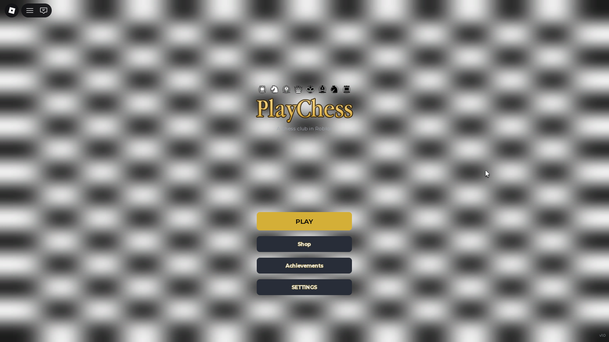
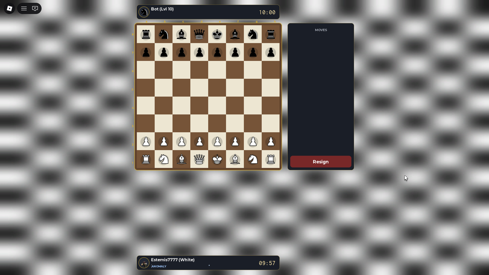
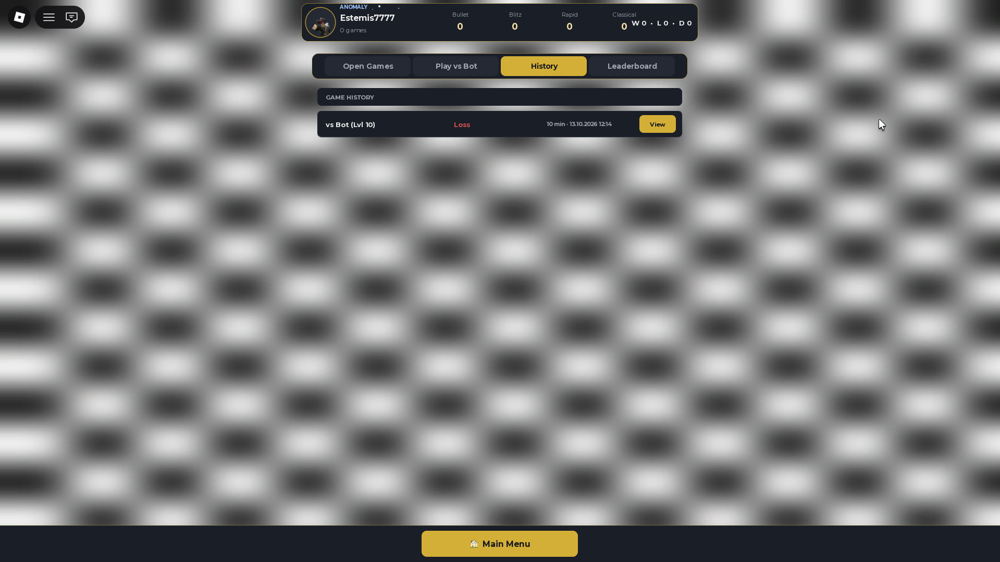
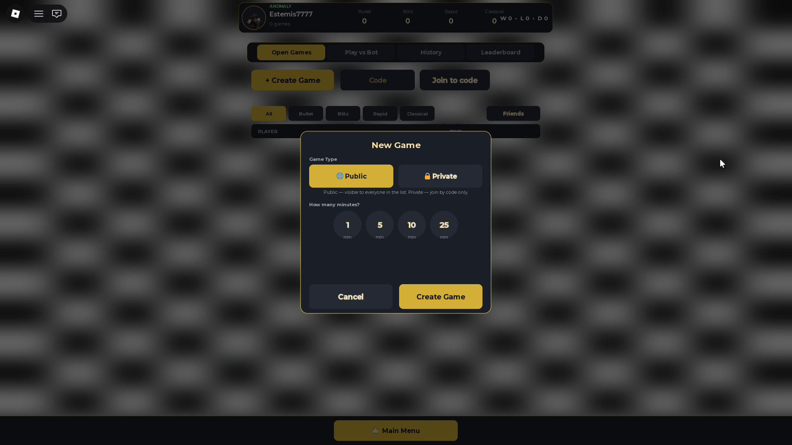
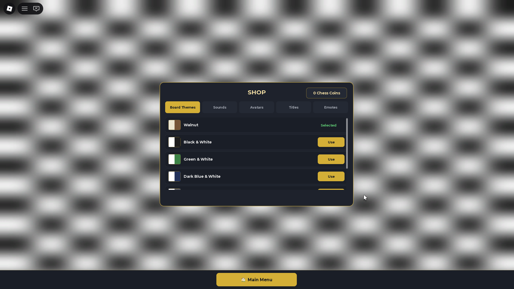

  

# ♟️ PlayChess

### *A full-featured chess club on Roblox*

---

## ♟️ About

**PlayChess** is a fully-featured chess game built inside Roblox. Play against bots of varying difficulty, challenge other players in real time, or invite friends to a private match with a code. Track your Elo, review your game history, customise your board — it's everything you'd expect from a dedicated chess platform, right inside Roblox.

> *"A chess club in Roblox — play, improve, compete."*

---

## 🎮 Gameplay

 
<em>A 10-minute game vs Bot (Lvl 10) — full 8×8 board with move history panel and resign button</em>

 

The chess engine handles all standard rules:

- ✅ Legal move validation
- ✅ Check & Checkmate detection
- ✅ Castling, En Passant, Pawn Promotion
- ✅ Turn-based timer per side
- ✅ Move history log (right panel)

---

## 🏛️ Lobby

 
<em>The lobby — browse open games, view your Elo ratings across game modes, check your history, and climb the leaderboard</em>

 

The lobby tracks your performance across **4 game modes**:

| Mode | Time Control | Style |
|------|-------------|-------|
| ♟ **Bullet** | 1 min | Ultra fast, pure instinct |
| ⚡ **Blitz** | 5 min | Fast and tactical |
| 🕐 **Rapid** | 10 min | Balanced and strategic |
| 🏆 **Classical** | 25 min | Deep calculation |

---

## ➕ Create a Game

 
<em>Create a public or private game — choose your time control (1 / 5 / 10 / 25 min)</em>

 

- **Public** — visible in the open games list for anyone to join
- **Private** — generate a code and share it with a friend to play 1v1

---

## 🛒 Shop

 
<em>Customise your experience — board themes, sounds, avatars, titles and emotes</em>

 

Spend your **Chess Coins** to unlock:

| Category | Examples |
|----------|---------|
| 🎨 **Board Themes** | Walnut, Black & White, Green & White, Dark Blue & White... |
| 🔊 **Sounds** | Custom move & capture sounds |
| 🧑 **Avatars** | Profile pictures for your account |
| 🏅 **Titles** | Display titles next to your name |
| 😄 **Emotes** | Reactions and gestures during the game |

---

## 🤖 Play vs Bot

Challenge AI opponents at different skill levels. The bot difficulty scales from beginner to advanced — perfect for practice and improvement before jumping into ranked matches.

---

## 🏆 Leaderboard & Stats

Track your progress with a full statistics system:

- **Elo rating** per game mode (Bullet / Blitz / Rapid / Classical)
- **Win / Loss / Draw** record
- **Game history** with timestamps and results viewable replay
- **Global leaderboard** to see where you rank

---

## 🛠️ Technical Highlights

Built entirely in **Roblox Studio** with **Luau**, featuring a custom-built chess engine implemented from scratch.

| Feature | Implementation |
|---------|---------------|
| **Chess engine** | Full rule validation in Luau (check, checkmate, special moves) |
| **Multiplayer** | Real-time PvP via Roblox RemoteEvents |
| **Bot AI** | Level-based move evaluation system |
| **Private games** | Code-based room system |
| **Elo system** | Rating calculation per game mode |
| **Shop system** | Chess Coins currency with cosmetic unlocks |
| **Persistent data** | Player stats & inventory saved via DataStore |
| **Game history** | Match records stored and viewable post-game |

---

## 🚀 Features at a Glance

- ✅ **Full chess rules** — all standard moves including castling, en passant, promotion
- ✅ **PvP multiplayer** — play against real players in real time
- ✅ **Bot opponents** — multiple difficulty levels
- ✅ **Private matches** — invite friends via code
- ✅ **4 time controls** — Bullet, Blitz, Rapid, Classical
- ✅ **Elo rating system** — separate rating per game mode
- ✅ **Game history** — review past matches
- ✅ **Global leaderboard**
- ✅ **Shop** — board themes, sounds, avatars, titles, emotes
- ✅ **Chess Coins** economy
- ✅ **Persistent data** — your stats are saved between sessions

---

## ▶️ Play Now

### ♟️ Make your move

*Free to play on Roblox · No download required*

---

## 👨‍💻 Developer

Built with ❤️ by **Estemis** in Roblox Studio — a fully custom chess engine, multiplayer system, and economy, all built from scratch in Luau.

Leave a 👍 on the Roblox page if you enjoyed a game!

---

♟️ Built with Roblox Studio &nbsp;·&nbsp; Scripted in Luau &nbsp;·&nbsp; Custom chess engine from scratch ♟️

